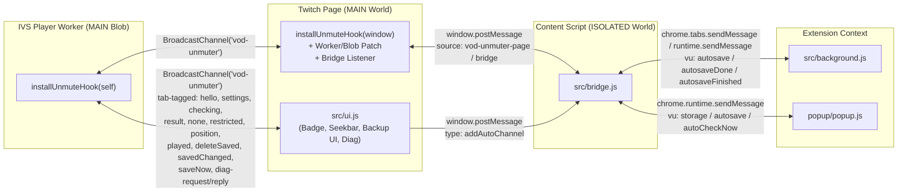
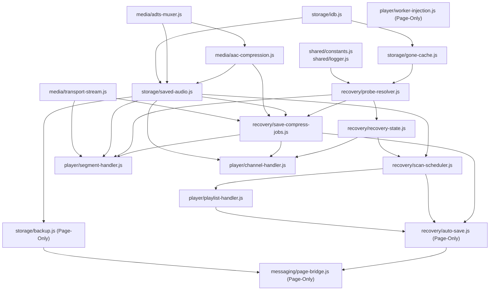

# Twitch VOD Unmuter — v1.4 Refactor & Modularization Plan (Audited & Upgraded)

**Target release:** `1.4.0`  
**Current baseline reviewed:** `main` (`b80d034`, [manifest.json](manifest.json) reports `1.3.0`)  
**Primary goal:** Break up the 2,097-line [src/hook.js](src/hook.js) monolith into cohesive, deterministic, unit-testable modules without breaking Web Worker injection, Mozilla AMO source-review compliance, user-visible playback behavior, or storage compatibility.  
**Approach:** Architecture seam proof first → fast offline unit test harness (`node --test`) → incremental extraction gated by both unit tests and the existing 19-suite live browser harness ([test/run.cjs](test/run.cjs)).

---

## 0. Executive Summary: What the Codebase Audit & Web Research Changed

Auditing every file in the repository and verifying browser/store constraints revealed **five critical gaps** in the initial draft plan that would have caused runtime failures or release delays if not corrected upfront:

> [!CAUTION]
> **1. The `installUnmuteHook(scope)` Dual-Execution Reality (91.7% of `hook.js` runs in BOTH Worker and Page)**  
> The initial plan proposed *"keeping the worker hook as one self-contained source file initially, while modularizing the page-side code around it"* as a fallback strategy. **The audit disproves this split:** [installUnmuteHook(scope)](src/hook.js#L34-L1956) spans **1,923 of the 2,097 lines (91.7%)** of `src/hook.js`, while only **140 lines** ([lines 1958–2097](src/hook.js#L1958-L2097)) live outside it.  
> More importantly, **IndexedDB persistence, quota eviction, deflate compression, and WebCodecs AAC re-encoding run directly inside the Web Worker** (`self.indexedDB`, `self.AudioEncoder`) during VOD playback, *and* also run inside the Page (`window`) during background auto-save (`twitch.tv/robots.txt`) and backup export/import. Any function extracted outside `installUnmuteHook` via plain top-level imports will break `installUnmuteHook.toString()` inside the `blob:` worker with a `ReferenceError`.

> [!WARNING]
> **2. Mozilla AMO Review Policy & the Zero-Dependency Build Promise**  
> [build.mjs](build.mjs#L1) has **zero npm dependencies** (`node build.mjs`), and [STORE_LISTING.md](STORE_LISTING.md#L189-L190) explicitly tells Mozilla reviewers: *"No build step changes the code... Nothing is minified, bundled or generated, so the uploaded files are the source."*  
> Per Mozilla Add-on (AMO) review policy, introducing a standard bundler like `esbuild` or Webpack triggers mandatory **Source Code Submission** and reproducible-build verification on every release, pushing updates out of fast review. Section 3 & Section 7 below present two superior architectures—**Runtime Factory Composition** (zero build transformation) and **Zero-Dependency Readable Assembly**—that keep outputs 100% human-readable and zero-dependency.

> [!IMPORTANT]
> **3. An 18-Suite Playwright + Firefox Test Harness Already Exists in `test/`**  
> The initial plan did not mention [test/](test/run.cjs). The repository already has [test/twitch-check.cjs](test/twitch-check.cjs) (20s live Twitch contract detector), 18 Chromium E2E suites in [test/suites/](test/suites/basic.cjs), and a Firefox BiDi/Selenium suite in [test/firefox/smoke.cjs](test/firefox/smoke.cjs). Crucially, [test/lib/browser.cjs](test/lib/browser.cjs#L46-L75) fails any test if `[VOD Unmuter]` logs a console warning/error or if an uncaught `pageerror` matches `/installUnmuteHook|vod-unmuter/i`, and multiple suites call `window.__vodUnmuterStore` and `window.__vodUnmuterDiag` directly. What is missing is a **fast, offline Node.js unit test suite (`node --test`)** for binary media/storage logic.

---

## 1. Audited Baseline & Execution-Context Matrix

### 1.1 Repository File Inventory

| Path | Size / Lines | Execution World | Audited Responsibility |
|---|---:|---|---|
| [src/hook.js](src/hook.js) | 99.0 KB / 2,097L | `MAIN` (`window`) + Injected `Worker` (`self`) | Dual-scope core (`installUnmuteHook`), MPEG-TS parser/splicer, ADTS/PES muxer, WebCodecs AAC re-encoder, 2 IndexedDB databases, `.vodunmuter` backup export/import, probe limiter, playlist rewriter, `fetch` hook, `Blob`/`URL`/`Worker` interception, `postMessage` storage/autosave bridge |
| [src/ui.js](src/ui.js) | 53.5 KB / 958L | `MAIN` (`window`) | Player control-bar counter/panel, seekbar range overlays & watched-fill gradient, hover tooltips, `/robots.txt#vod-unmuter-backup` page UI, diagnostic report builder (`window.__vodUnmuterDiag`), 1 Hz playback position/played tracker |
| [src/background.js](src/background.js) | 13.3 KB / 293L | Extension Service Worker (Chrome) / Background Script (Firefox) | 20-min `vu-autosave` alarm, serialized `autoState` queue, Twitch GraphQL VOD discovery (`ARCHIVE`), background tab lifecycle (`robots.txt`), badge (`…` / `!`), notifications, install welcome tab |
| [src/bridge.js](src/bridge.js) | 4.9 KB / 96L | `ISOLATED` Content Script | `chrome.storage.sync` settings relay to `MAIN`, `addAutoChannel` handler, popup `storage` request/reply proxy (`askPage`), `savedCache` snapshot in `chrome.storage.local`, background `autosave` runner |
| [popup/popup.js](popup/popup.js) | 20.5 KB / 417L | Extension Popup | 4-tab UI (`Settings`, `Auto-save`, `Saved`, `Help`), Firefox AAC feature detection, channel group rendering, pin/export/delete actions, `savedCache` read-only fallback, self-check status dot |
| [popup/welcome.js](popup/welcome.js) | 2.0 KB / 39L | Extension Tab | First-run onboarding page, quick auto-save channel adder, Firefox lossless note |
| [build.mjs](build.mjs) | 6.4 KB / 164L | Node 18+ Build CLI | CWS 132-char description check, strict UTF-8 / Unicode non-character check (`U+FDD0..U+FDEF`, `U+FFFE/FFFF`), Chrome/Firefox manifest split, deterministic DOS-date ZIP writer |
| [test/run.cjs](test/run.cjs) | 19 suites | Node + Playwright + Geckodriver | Live-VOD E2E browser tests across Chromium (`Extensions.loadUnpacked` via CDP) and Firefox (`installAddon` + WebDriver BiDi `LogInspector`) |

### 1.2 Where Each Part of `src/hook.js` Actually Runs

Before extracting a single function, every subsystem in `src/hook.js` must be classified by whether it executes in the **Player Worker (`IS_PAGE === false`)**, the **Page (`IS_PAGE === true`)**, or **Both**:

| Subsystem in `src/hook.js` | Runs in Player Worker (`self`)? | Runs in Page (`window`)? | Why Both / Why Single Scope? |
|---|:---:|:---:|---|
| Logger, constants, settings, `BroadcastChannel` | **Yes** | **Yes** | Both log to `logLines`, receive `settings` and `diag-request`, and report via `diag-reply` |
| MPEG-TS `scanTs`, `extractAudio`, `spliceAudio` | **Yes** | **Yes** | Worker splices during playback & extracts during saving; Page extracts during `autoSave` & exposes on `window.__vodUnmuterDebug` |
| ADTS / PES `packetsToAdts`, `splitAdts`, `muxAdts` | **Yes** | **Yes** | Worker muxes AAC records during playback (`loadSaved`) & splits ADTS during compression; Page uses them during `autoSave` compression |
| IndexedDB `vod-unmuter` & `vod-unmuter-gone` CRUD | **Yes** | **Yes** | Worker reads/writes saved segments & `gone` cache during VOD checks/playback; Page reads/writes during `autoSave`, popup commands, and backups |
| WebCodecs AAC compression (`encoderDelay`, `reencode`, `runCompress`) | **Yes** | **Yes** | Worker compresses saved audio 15s after VOD check finishes; Page compresses at end of `autoSave(vodId)` |
| Probing, resolution, scan scheduler, `maybeSaveAll` | **Yes** | **Yes** | Worker checks/saves watched VODs; Page checks/saves background `autoSave(vodId)` VODs (and fallback main-thread player) |
| Playlist `readMaster`, `rewritePlaylist`, `fetch` hook | **Yes** | **Yes** | Worker intercepts IVS player `fetch`; Page uses `readMaster`/`rewritePlaylist` in `autoSave` and hooks `window.fetch` as fallback |
| `exportSaved`, `readBackupHeader`, `importSaved` | *No* (dead weight in worker today) | **Yes** (`__vodUnmuterStore`) | Only ever called via `window.__vodUnmuterStore` on `twitch.tv/robots.txt#vod-unmuter-backup` |
| `autoSave(vodId)` | *No* (dead weight in worker today) | **Yes** (`__vodUnmuterAuto`) | Only ever called via `window.__vodUnmuterAuto.save(vodId)` from `answerStorage` in page context |
| `Blob`, `URL`, `Worker` monkey-patching ([L1974–2044](src/hook.js#L1974-L2044)) | **No** | **Yes** | Page-only bootstrap that injects `hookSource` into Twitch's IVS worker |
| `window.postMessage` bridge & `answerStorage` ([L2049–2096](src/hook.js#L2049-L2096)) | **No** | **Yes** | Page-only relay between `bridge.js` (ISOLATED world) and `MAIN` world |

---

## 2. Hard Compatibility & ABI Contracts (Must Preserve)

Every item below is depended on by other files or by `test/suites/*.cjs` and must remain 100% compatible throughout v1.4:

### 2.1 Global Symbols & Test Hooks
1. **`installUnmuteHook` function name:** [test/lib/browser.cjs](test/lib/browser.cjs#L72) checks `/installUnmuteHook|vod-unmuter/i` to detect extension `pageerror` crashes.
2. **`__vodUnmuterHooked` marker (`MARK`):** Checked on `scope.__vodUnmuterHooked` and via `text.includes('__vodUnmuterHooked')` in both the `Blob` and `Worker` constructors to prevent double-wrapping when competing extensions (`test/suites/race.cjs`) re-wrap `Worker`.
3. **`window.__vodUnmuterLoaded` & `window.__vodUnmuterUI`:** Top-level idempotency guards.
4. **`window.__vodUnmuterTab` / `self.__vodUnmuterTab`:** Per-tab 8-char ID injected as `self.__vodUnmuterTab = "<id>";` at the top of the worker script so `BroadcastChannel('vod-unmuter')` messages stay tab-scoped (`test/suites/tabs.cjs`).
5. **`window.__vodUnmuterStore`:** Must expose `{ list, remove, expire, exportSaved, importSaved, readBackupHeader, clearGone, pin }`. Directly invoked by [src/ui.js](src/ui.js#L60) and evaluated by [test/run.cjs](test/run.cjs#L46), [test/suites/ahead-open.cjs](test/suites/ahead-open.cjs#L30), [test/suites/backup.cjs](test/suites/backup.cjs#L28), and [test/suites/unplayed.cjs](test/suites/unplayed.cjs#L33).
6. **`window.__vodUnmuterAuto`:** Must expose `{ save(vodId) }`.
7. **`window.__vodUnmuterDiag`:** Defined by `src/ui.js`, called by `src/hook.js` (`answerStorage` when `action === 'diag'`) and by [test/suites/basic.cjs](test/suites/basic.cjs#L13) and [test/firefox/smoke.cjs](test/firefox/smoke.cjs#L47).
8. **`scope.__vodUnmuterDebug`:** Exposes `{ jobs, renditions, scanTs, extractAudio, spliceAudio, listSaved, loadRecord, recordToAudio, muxAdts, splitAdts, packetsToAdts, encoderDelay }` on both `window` and worker `self`.

### 2.2 Cross-World Messaging Protocols



### 2.3 Storage & Binary Format Schemas
- **IndexedDB `vod-unmuter` (version 1):**
  - Object store `audio` (out-of-line keys `"<vodKey>|<segNum>"`):
    - Legacy uncompressed: `{ type: number, pts: number, packets: Uint8Array }`
    - Lossless deflate: `{ fmt: 'deflate', type: number, pts: number, data: Uint8Array, packed: boolean }`
    - Re-encoded AAC: `{ fmt: 'aac', type: 0x0f, pts: number, kbps: number, data: Uint8Array }`
  - Object store `vods` (`keyPath: 'vod'`):
    - `{ vod, channel, streamedAt, savedAt, segments, bytes, muted?, restorable?, checkedAt?, pinned?, behind? }`
    - Note: Records with `segments === 0` are intentionally retained when `behind` is set ("Parts ahead of me" mode) and filtered out by `listSaved(false)`.
- **IndexedDB `vod-unmuter-gone` (version 1):**
  - Object store `gone` (`keyPath: 'vod'`): `{ vod, updated, files: { "<quality>/<suffix>": number[] } }`
- **Backup file format (`.vodunmuter`, format version 1):**
  - Magic bytes `"VODUNMUTER-BACKUP\n"` (18 bytes) + 4-byte uint32LE header byte length + UTF-8 JSON header `{ format: 1, app: 'Twitch VOD Unmuter', exported: number, vods: VodInfo[], audio: [{ key, rec }] }` (where binary fields are replaced with `{ $bin: [offset, byteLength] }`) + concatenated binary payloads.

---

## 3. Solving the Core Architectural Challenge: Modularizing `installUnmuteHook`

Because `installUnmuteHook` must be injected as a self-contained string into Twitch's `blob:` Web Worker (`hookSource`), **how modules are combined** is the single most important architectural decision of v1.4.

### Evaluation of the 3 Technical Strategies

| Criterion | Strategy A: Zero-Dep Readable Assembler in `build.mjs` (Recommended) | Strategy B: Multi-File `manifest.json` + `fn.toString()` Module Registry | Strategy C: Third-Party Bundler (`esbuild` IIFE) |
|---|---|---|---|
| **How `src/` is authored** | Standard ES modules (`import` / `export`) under `src/hook/*.js` | Self-contained factory functions `function installX(ctx) { ... }` registered on an array; listed in `manifest.json` `content_scripts[0].js` | Standard ES modules (`import` / `export`) bundled by `esbuild` |
| **How Worker injection works** | `build.mjs` assembles the worker-scoped modules inside `function installUnmuteHook(scope) { ... }` in `dist/*/src/hook.js`; `installUnmuteHook.toString()` works unchanged | Bootstrap iterates `modules.map(m => '(' + m.toString() + ')(ctx);').join('\n')` to build `hookSource` at runtime | Need custom dual-build (`worker.iife.js` embedded as string constant into `hook.js`) |
| **Node.js unit testing (`node --test`)** | Native ES module imports (`import { scanTs } from '../src/media/ts.js'`) work directly in Node 18+ with zero wrappers! | Requires calling `installX(mockCtx)` or CommonJS dual exports | Native ES module imports work in Node |
| **Zero npm dependencies at root?** | **Yes** (`node build.mjs` stays pure Node 18+ stdlib) | **Yes** | **No** (requires `package.json`, `node_modules`, platform binary `esbuild`) |
| **Mozilla AMO Reviewer Policy** | Output in `dist/` is unminified, human-readable concatenated source with file banners; add 1-line build command to AMO notes (or ship `src/` modules + built `hook.js`) | `build.mjs` copies files 1:1 with zero transformation | Triggers mandatory AMO Source Code Upload + lockfile build audit |
| **Single content-script injection atomicity** | **Yes** (`dist/*/src/hook.js` remains 1 file at `document_start`) | `manifest.json` lists ~10 files in `content_scripts[0].js` | **Yes** |

> [!TIP]
> **Recommendation: Choose Strategy A (Zero-Dependency Readable Assembler in `build.mjs`), or Hybrid A+B.**  
> Why Strategy A wins:
> 1. **Pure ES Modules in `src/`:** Every extracted file (`src/media/transport-stream.js`, `src/storage/saved-audio.js`, etc.) uses standard `export function ...` and `import { ... }`. Node 18+'s built-in test runner (`node --test`) can import and unit-test every module directly with zero mocking ceremony.
> 2. **Zero external dependencies:** `build.mjs` already builds ZIPs and manifests in 164 lines of pure Node stdlib. Adding a ~45-line topological assembler that strips intra-hook `import`/`export` keywords and places the modules inside `function installUnmuteHook(scope) { ... }` (and page-only modules outside it!) requires **zero npm packages** and produces a clean, readable, comment-preserved `dist/{chrome,firefox}/src/hook.js`.
> 3. **Smaller Worker Payload:** Because the assembler knows which modules are shared (`scope`-level) vs. page-only (`backup.js`, `auto-save.js`, `worker-injection.js`, `bridge-protocol.js`), `installUnmuteHook.toString()` no longer injects backup export/import or auto-save GraphQL code into every Twitch IVS worker!
> 4. **Verification Gate:** `build.mjs` can run `new vm.Script(output)` (or `node --check`) on the assembled `dist/*/src/hook.js` and also verify that `installUnmuteHook.toString()` executes cleanly in a bare `vm.createContext({ self: {} })` sandbox with no outer scope access!

---

## 4. Target Architecture & Dependency Graph

### 4.1 Proposed Directory Layout

Do not over-fragment into 25 tiny 30-line files. Group by **actual state ownership and execution boundary** into **12 focused modules** under `src/`:

```text
src/
├── hook.js                          # Entry template / bootstrap (or assembled output in dist/)
├── shared/
│   ├── constants.js                 # TAG, CHANNEL, SUFFIXES, MUTED_RE, GONE_RE, limits, defaults
│   └── logger.js                    # shortUrl, describeArg, createLogger(where, getSettings)
├── media/
│   ├── transport-stream.js          # Pure: scanTs, extractAudio, spliceAudio
│   ├── adts-muxer.js                # Pure: concat, packetsToAdts, splitAdts, adtsInfo, muxAdts
│   └── aac-compression.js           # WebCodecs: deflate, inflate, decodeFrames, encodePcm, encoderDelay, reencode
├── storage/
│   ├── idb.js                       # openDb, idb, openGoneDb, goneTx, audioRange, vodInfo, recBytes
│   ├── saved-audio.js               # loadSavedNums, loadRecord, recordToAudio, loadSaved, putRecord,
│   │                                # deleteSavedSegment, deleteSavedVod, updateVodInfo, listSaved, expireSaved, makeRoom
│   ├── gone-cache.js                # markMissing, flushGone, loadGone, clearGone, expireGone
│   └── backup.js                    # Page-only: BACKUP_MAGIC, exportSaved, readBackupHeader, importSaved
├── recovery/
│   ├── probe-resolver.js            # makeLimiter, probeOnce, probe, allDirs, saveDirs, donorDirs,
│   │                                # donorSources, urlFor, findOwn, findDonor, setResult, resolveSegment
│   ├── recovery-state.js            # describe, reasonOf, buildRanges, isCurrent, switchVod,
│   │                                # noteActivity, sendResult, sendState, throttledProgress, scheduleResult
│   ├── scan-scheduler.js            # checkSegments, makeCurrent, checkMore, checkAll, retryUnknown, noteVodTotals
│   ├── save-compress-jobs.js        # serially, saveFromBytes, maybeSaveAll, dropBehind,
│   │                                # scheduleCompress, leadInFrames, compressJob, runCompress
│   └── auto-save.js                 # Page-only: autoSave(vodId)
├── player/
│   ├── playlist-handler.js          # readMaster, rewritePlaylist, handleOther
│   ├── segment-handler.js           # segmentResponse, spliced, fetchSegment, confirm
│   ├── channel-handler.js           # BroadcastChannel listener inside installUnmuteHook
│   └── worker-injection.js          # Page-only: isPlayerWorkerCode, Blob/URL/Worker wrappers
├── messaging/
│   └── page-bridge.js               # Page-only: relay, answerStorage, window.postMessage listener
├── ui.js                            # Unchanged in v1.4 (958 lines; candidate for v1.5)
├── background.js                    # Unchanged in v1.4 (293 lines)
└── bridge.js                        # Unchanged in v1.4 (96 lines)
```

### 4.2 Acyclic Module Dependency Direction



---

## 5. Line-Accurate Function & State Extraction Map from `src/hook.js`

Every function and mutable state variable in [src/hook.js](src/hook.js) is accounted for below, including its hidden closure dependencies:

### 5.1 Shared Context State (`ctx` / `scope` closure)
Currently, `installUnmuteHook(scope)` holds these shared mutable bindings across subsystems:
- **Environment:** `scope`, `realFetch` ([L89](src/hook.js#L89)), `IS_PAGE` ([L40](src/hook.js#L40)), `WHERE` ([L41](src/hook.js#L41)), `INSTANCE` ([L44](src/hook.js#L44)), `ORIGIN` ([L52](src/hook.js#L52)), `RESTRICTED` ([L54](src/hook.js#L54)), `TAB` ([L124](src/hook.js#L124))
- **Live Settings & Status Flags:** `settings` ([L90](src/hook.js#L90)), `storageFull` ([L558](src/hook.js#L558)), `aacSupported` ([L570](src/hook.js#L570))
- **Maps & Collections:**
  - `known` (`Map<url, boolean>`, [L127](src/hook.js#L127))
  - `pending` (`Map<url, Promise<boolean|null>>`, [L128](src/hook.js#L128))
  - `segments` (`Map<rewrittenTsUrl, Segment>`, [L129](src/hook.js#L129))
  - `playlists` (`Map<playlistUrl, { text, raw, job }>`, [L130](src/hook.js#L130))
  - `renditions` (`Map<vodBase, string[]>`, [L131](src/hook.js#L131))
  - `jobs` (`Job[]`, [L1057](src/hook.js#L1057)), `currentJob` ([L1058](src/hook.js#L1058)), `noneCurrent` ([L1059](src/hook.js#L1059))
- **Messaging:** `channel` ([L120](src/hook.js#L120)), `post(msg)` ([L125](src/hook.js#L125))

> [!IMPORTANT]
> **Circular-Coupling Knot Discovered in Audit:**  
> Look at how `storage` currently reaches back into `recovery/jobs`:
> 1. `markMissing(url)` ([L330](src/hook.js#L330)) looks up `jobs.find((j) => url.startsWith(j.vodBase))` and writes `known.set(url, false)`.
> 2. `putRecord(vod, num, rec, replace)` ([L526](src/hook.js#L526)) catches `QuotaExceededError`, sets `storageFull = true`, and iterates `for (const j of jobs) if (j.vodKey === vod) { j.limitReached = true; j.storageFull = true; scheduleResult(j); }` ([L553](src/hook.js#L553)).
> 3. `expireSaved(keepDays)` ([L744](src/hook.js#L744)) calls `expireGone()`.
>
> **How to untangle cleanly during Phase 3:**
> - Pass `{ onQuotaExceeded(vod) }` callback (or return `{ quotaExceeded: true }` from `putRecord` to `saveFromBytes`/`runCompress`) so `storage/saved-audio.js` does not mutate `jobs` or call `scheduleResult(j)` directly!
> - Pass `(vodKey, vodBase, isLive)` or resolve the job in `probeOnce`/`fetchSegment`/`maybeSaveAll` before calling `markMissing`, so `storage/gone-cache.js` does not depend on `jobs`!

### 5.2 Detailed Extraction Table

| Module | Lines in `src/hook.js` | Functions & Symbols to Move | Couplings to Decouple |
|---|---|---|---|
| `shared/constants.js` | [L28](src/hook.js#L28), [L38–45](src/hook.js#L38-L45), [L82–100](src/hook.js#L82-L100), [L133–137](src/hook.js#L133-L137), [L300](src/hook.js#L300), [L325](src/hook.js#L325), [L461](src/hook.js#L461), [L565](src/hook.js#L565), [L756–758](src/hook.js#L756-L758), [L1150–1157](src/hook.js#L1150-L1157) | `CHANNEL_NAME`, `TAG`, `PLAYING_MS`, `LOG_KEEP`, `SUFFIXES`, `MUTED_RE`, `MAX_PARALLEL`, `SAVE_PARALLEL`, `FALLBACK_DIRS`, `DEFAULT_SETTINGS`, `AHEAD_MIN_PLAY`, `POSITION_WAIT_MS`, `GONE_KEEP_DAYS`, `GONE_RE`, `ADTS_RATES`, `KBPS`, `BACKUP_MAGIC`, `BACKUP_FORMAT`, `AUDIO_KEY_RE`, `SAMPLE_SIZE`, `ALL_GONE_AFTER_H`, `SKIP_REST_AFTER_H`, `isMiss`, `sleep`, `requestFor`, `prettyQuality`, `jobName`, `isBehind`, `notAhead` | Pure functions and constants; zero state dependencies. |
| `shared/logger.js` | [L61–79](src/hook.js#L61-L79) | `shortUrl`, `describeArg`, `logLines`, `log(level, ...args)` | Reads `WHERE` and `settings.debug`. Export `shortUrl` and `describeArg` as pure helpers for unit tests. |
| `media/transport-stream.js` | [L141–238](src/hook.js#L141-L238) | `scanTs(buf)`, `extractAudio(buf)`, `spliceAudio(target, audio)` | **100% pure** (`Uint8Array` in → `Uint8Array` / object out). Zero DOM/IDB/scope dependencies. |
| `media/adts-muxer.js` | [L421–426](src/hook.js#L421-L426), [L438–500](src/hook.js#L438-L500) | `concat(parts)`, `packetsToAdts(packets)`, `splitAdts(es)`, `adtsInfo(f)`, `muxAdts(frames, pts, sampleRate)` | **100% pure** binary transformations. |
| `media/aac-compression.js` | [L428–435](src/hook.js#L428-L435), [L565–678](src/hook.js#L565-L678) | `pipeBytes`, `deflate`, `inflate`, `delays`, `codecsAvailable`, `aacSupported` probe, `decodeFrames`, `encodePcm`, `encoderDelay`, `reencode` | Uses `scope.AudioEncoder`, `scope.AudioDecoder`, `scope.EncodedAudioChunk`, `scope.AudioData`, `CompressionStream`, `DecompressionStream`, `concat`, `log`. |
| `storage/idb.js` | [L244–282](src/hook.js#L244-L282), [L301–323](src/hook.js#L301-L323), [L420](src/hook.js#L420) | `openDb`, `idb`, `openGoneDb`, `goneTx`, `audioRange`, `vodInfo`, `recBytes` | Uses `scope.indexedDB`, `IDBKeyRange`, `log`. Note: `vodInfo` and `recBytes` are pure and testable offline. |
| `storage/gone-cache.js` | [L325–412](src/hook.js#L325-L412) | `goneQueue`, `goneTimer`, `markMissing`, `flushGone`, `loadGone`, `clearGone`, `expireGone` | Uses `goneTx`, `known`. Decouple job lookup so `markMissing` takes `(url, job)` or looks up via injected getter. |
| `storage/saved-audio.js` | [L284–292](src/hook.js#L284-L292), [L503–558](src/hook.js#L503-L558), [L681–749](src/hook.js#L681-L749), [L1290–1304](src/hook.js#L1290-L1304) | `loadSavedNums`, `recordToAudio`, `loadRecord`, `loadSaved`, `putRecord`, `storageFull`, `deleteSavedSegment`, `deleteSavedVod`, `updateVodInfo`, `listSaved`, `expireSaved`, `makeRoom` | Uses `idb`, `inflate`, `splitAdts`, `adtsInfo`, `muxAdts`, `expireGone`. Decouple `QuotaExceededError` job notification via callback. |
| `storage/backup.js` | [L756–868](src/hook.js#L756-L868) | `exportSaved`, `readBackupHeader`, `importSaved` | **Page-only!** Uses `listSaved`, `idb`, `audioRange`, `vodInfo`, `recBytes`, `post({ type: 'savedChanged', vodKey })`. Does not need to be injected into the worker! |
| `recovery/probe-resolver.js` | [L881–987](src/hook.js#L881-L987), [L1337–1343](src/hook.js#L1337-L1343) | `makeLimiter`, `limited`, `saveLimited`, `probeOnce`, `probe`, `allDirs`, `saveDirs`, `donorDirs`, `donorSources`, `urlFor`, `findOwn`, `findDonor`, `setResult`, `resolveSegment` | Note that `donorDirs` calls `saveDirs`, so co-locating `saveDirs` here avoids a circular dependency between `probe-resolver` and `save-compress-jobs`. |
| `recovery/recovery-state.js` | [L996–1148](src/hook.js#L996-L1148) | `describe`, `reasonOf`, `buildRanges`, `jobs`, `currentJob`, `noneCurrent`, `isCurrent`, `switchVod`, `noteActivity`, `sendResult`, `sendState`, `throttledProgress`, `scheduleResult` | `describe`, `reasonOf`, `buildRanges` are pure functions of segment arrays and should be unit-tested directly. |
| `recovery/scan-scheduler.js` | [L725–732](src/hook.js#L725-L732), [L1162–1274](src/hook.js#L1162-L1274) | `noteVodTotals`, `checkSegments`, `makeCurrent`, `checkMore`, `checkAll`, `retryUnknown` | Coordinates `resolveSegment`, `loadSavedNums`, `loadGone`, `dropBehind`, `maybeSaveAll`, `scheduleCompress`. |
| `recovery/save-compress-jobs.js` | [L104–118](src/hook.js#L104-L118), [L1277–1286](src/hook.js#L1277-L1286), [L1308–1492](src/hook.js#L1308-L1492) | `dropBehind`, `noteSaved`, `saveQueue`, `serially`, `saveFromBytes`, `maybeSaveAll`, `scheduleCompress`, `leadInFrames`, `compressJob`, `runCompress` | Coordinates background downloading, `serially` quota checks, `putRecord`, and WebCodecs re-encoding. |
| `recovery/auto-save.js` | [L1498–1556](src/hook.js#L1498-L1556) | `autoSave(vodId)` | **Page-only** (`scope.document.cookie`, `window.__vodUnmuterAuto`). Calls `readMaster`, `rewritePlaylist`, `maybeSaveAll`, `compressJob`. |
| `player/playlist-handler.js` | [L1559–1671](src/hook.js#L1559-L1671), [L1893–1943](src/hook.js#L1893-L1943) | `readMaster`, `rewritePlaylist`, `restrictedNoted`, `handleOther` | Parses master & media `.m3u8` playlists, manages live-growing playlists and unmuted-segment pruning. |
| `player/segment-handler.js` | [L1674–1781](src/hook.js#L1674-L1781), [L1945–1953](src/hook.js#L1945-L1953) | `segmentResponse`, `spliced`, `fetchSegment`, `confirm`, `scope.fetch` override | Real-time segment recovery cascade: own `.ts`/`-unmuted.ts` → saved IDB copy → urgent parallel donor probe + splice → muted fallback. |
| `player/channel-handler.js` | [L1784–1890](src/hook.js#L1784-L1890) | `channel.addEventListener('message', ...)` and initial `post({ type: 'hello', where: WHERE })` | Handles `settings`, `deleteSaved`, `position`, `played`, `diag-request`, `savedChanged`, `saveNow`. |
| `player/worker-injection.js` | [L1961–2044](src/hook.js#L1961-L2044) | `hookSource`, `MARK`, `isPlayerWorkerCode`, `blobText`, `urlText`, `window.Blob`, `URL.createObjectURL`, `URL.revokeObjectURL`, `window.Worker` | **Page-only.** Prepends `hookSource` to IVS workers via both `Blob` and `Worker` constructors. |
| `messaging/page-bridge.js` | [L2049–2096](src/hook.js#L2049-L2096) | `lastSettings`, `relay`, `answerStorage`, `window.addEventListener('message', ...)`, initial `getSettings` post | **Page-only.** Bridges `src/bridge.js` (ISOLATED world) to `__vodUnmuterStore`, `__vodUnmuterAuto`, `__vodUnmuterDiag`, and `BroadcastChannel`. |

---

## 6. Concrete Reliability Findings & Edge Cases from the Codebase Audit

The initial draft plan listed general areas to review. Below are the **specific, line-verified technical findings** uncovered during the audit of `src/hook.js`. Per refactoring discipline, **do not alter behavior during file-move commits**; instead, lock current behavior with unit tests first, then address confirmed bugs in dedicated, isolated `fix:` commits if needed.

### 6.1 MPEG-TS & ADTS Binary Parsing Bounds & Wrap-Around
1. **Missing Packet-Bounds Check After Adaptation Field in `scanTs` ([src/hook.js#L151-L171](src/hook.js#L151-L171)):**
   - `let p = o + 4 + ((afc & 2) ? 1 + buf[o + 4] : 0);` does not verify `p < o + 188` (or `p + 14 <= o + 188` when reading PTS bytes `buf[p + 9 .. p + 13]`). A malformed adaptation field length byte `buf[o + 4] >= 183` causes `scanTs` to read across packet boundaries or past `buf.length`.
   - Similarly, in `packetsToAdts` ([src/hook.js#L445](src/hook.js#L445)), `if (packets[o + 1] & 0x40) { p += 9 + packets[p + 8]; started = true; }` assumes the PES header starts at `p` without checking `p + 9 <= o + 188` or the `0x000001` start code prefix.
2. **33-Bit PTS Modulo Wrap-Around in `spliceAudio` ([src/hook.js#L199](src/hook.js#L199)):**
   - `Math.abs(t.pts - audio.pts) > 9000` compares raw 33-bit PTS values ($0 \dots 2^{33}-1$, where `muxAdts` wraps at `8589934592`). If a stream's 90 kHz clock wraps around $2^{33}$ (~26.5 hours), `Math.abs(t.pts - audio.pts)` near the wrap point will exceed `9000` unless modular distance is used.
   - *(Note: Bitwise shifting `(buf[p + 10] << 22)` in `scanTs` line 170 was audited for 32-bit signed overflow and confirmed **safe**: bit 7 of `buf[p + 10]` shifts to bit 29, staying below the signed 32-bit sign bit 31.)*
3. **Continuity Counter Alignment Across Spliced → Normal Segment Transitions ([src/hook.js#L216-L226](src/hook.js#L216-L226)):**
   - `spliceAudio` aligns the *first* spliced audio packet's continuity counter (`firstCC`) with the target muted segment's first audio packet (`ccShift = (firstCC - (src[3] & 0x0f) + 16) % 16`).
   - When `src` comes from an identical-bitrate rendition (`audio_only`, `480p+`), packet count matches. When `src` comes from re-encoded AAC (`muxAdts` with `PER_PES = 4`) or lower-bitrate `360p`/`160p`, total audio packet count `count` differs from the muted segment's original audio packet count, shifting the ending continuity counter at the boundary into segment $N+1$. Unit and media-decoder tests should verify both same-count and different-count splices.

### 6.2 Memory Retention Across Long SPA Sessions
1. **Unbounded Maps on SPA Navigation ([src/hook.js#L127-L131](src/hook.js#L127-L131), [L1057](src/hook.js#L1057)):**
   - While `autoSave` cleans up its `job` and `segments` entries in its `finally` block ([L1550–1553](src/hook.js#L1550-L1553)), normal player jobs in `jobs`, full playlist texts in `playlists`, rewritten URLs in `segments`, and probe results in `known` are never pruned when the viewer navigates across many VODs in a single Twitch SPA tab.
   - Do not change eviction policy during extraction commits, but structure `player-context` / `recovery-state` so per-VOD state ownership is explicit and easy to bound in a follow-up commit.
2. **Unrevoked Blob URL Cache ([src/hook.js#L1983](src/hook.js#L1983)):**
   - `urlText` (`Map<blobUrl, string>`) holds the full text of string Blobs until `URL.revokeObjectURL` is called. `window.Blob` ([L1996](src/hook.js#L1996)) stores `blobText.set(this, text)` for **every** string-array Blob created by Twitch on the page (not just worker blobs!), and `URL.createObjectURL` copies it into `urlText`. Bounding or filtering `urlText` (or only caching blobs matching worker heuristics) is a good post-refactor hardening item.

### 6.3 Divergent Urgent vs. Background Donor Probing (Must Not Unify Accidentally)
- Background `findDonor(seg, dirs)` ([L962–969](src/hook.js#L962-L969)) probes donor qualities **sequentially** (`for (const source of donorSources(seg, dirs))`), stopping at the first hit (usually `audio_only/.ts`).
- Real-time playback `fetchSegment(seg, input, init)` ([L1735–1739](src/hook.js#L1735-L1739)) probes all donor qualities **in parallel with `urgent = true`** (`Promise.all(donors.map((s) => probe(urlFor(seg, s), true)))`) so playback never stalls behind the 48-slot background queue or sequential round-trips.
- **Rule for Phase 3/4:** Keep sequential background `findDonor` and parallel urgent `fetchSegment` donor probing distinct.

### 6.4 Settings Defaults & Constants Duplication Across the Extension
- `DEFAULTS` is currently defined 5 times across `src/hook.js`, `src/ui.js`, `src/bridge.js`, `src/background.js`, and `popup/popup.js` with slightly different key subsets.
- In v1.4, document the canonical settings schema in `src/shared/constants.js` and add a static test verifying that `hook.js`, `ui.js`, `bridge.js`, `background.js`, and `popup.js` agree on all shared default values (`enabled: true`, `badge: true`, `recolor: true`, `saveAudio: true`, `saveMode: 'whole'`, `keepDays: 60`, `saveQuality: 'high'`, `maxStorageMB: 1000`, `autoOpenTab: true`, `debug: false`, `notify: false`, `autoChannels: []`).

### 6.5 Documentation Drift Found in Audit
- [README.md](README.md#L492-L493) still lists `PLAN-1.3.md` and `ROADMAP.md` under `## Project files`, even though commit `575702a` deleted both files. Clean this up alongside the v1.4 documentation update in `README.md`.

---

## 7. Build & Packaging Plan (`build.mjs`)

### 7.1 Design Requirements
1. **Zero npm dependencies for building:** `node build.mjs` must continue to work on a fresh checkout with only Node.js 18+.
2. **Exact same output structure in `dist/`:**
   - `dist/chrome/` and `dist/firefox/` unpacked folders
   - `dist/twitch-vod-unmuter-chrome-<version>.zip` and `dist/twitch-vod-unmuter-firefox-<version>.zip`
   - `manifest.json` `content_scripts[0].js` continues to load `["src/hook.js", "src/ui.js"]`.
3. **Human-readable output for Mozilla AMO:**
   - No minification, no identifier mangling, no webpack/esbuild runtime boilerplate.
   - Each assembled module in `dist/{chrome,firefox}/src/hook.js` is preceded by a clear banner (`// ---- src/media/transport-stream.js ----`) and preserves all original comments and indentation.
   - Update the AMO reviewer notes in [STORE_LISTING.md](STORE_LISTING.md#L189-L190) to note that `node build.mjs` concatenates the modular files in `src/` into `dist/*/src/hook.js` without minification or third-party bundlers.

### 7.2 How `build.mjs` Assembles `src/hook.js`
1. Define two explicit, ordered module lists in `build.mjs`:
   - `WORKER_AND_PAGE_MODULES`: modules assembled *inside* `function installUnmuteHook(scope) { ... }` (`shared/*`, `media/*`, `storage/idb.js`, `storage/gone-cache.js`, `storage/saved-audio.js`, `recovery/probe-resolver.js`, `recovery/recovery-state.js`, `recovery/scan-scheduler.js`, `recovery/save-compress-jobs.js`, `player/playlist-handler.js`, `player/segment-handler.js`, `player/channel-handler.js`).
   - `PAGE_ONLY_MODULES`: modules assembled *outside* `installUnmuteHook(scope)` (or guarded inside page bootstrap so they are NOT part of `installUnmuteHook.toString()`): `storage/backup.js`, `recovery/auto-save.js`, `player/worker-injection.js`, `messaging/page-bridge.js`.
   - *(Note: If `autoSave` and `backup` are kept inside the `installUnmuteHook` closure in Phase 1–4 for zero-risk lexical access to `readMaster`, `rewritePlaylist`, `idb`, and `listSaved`, they can initially stay in `WORKER_AND_PAGE_MODULES` and only move out once a clean `scope.__vodUnmuterInternals` seam is proven.)*
2. For each module file in `src/`:
   - Strip top-level `import { ... } from '...';` lines and `export ` keywords.
   - Verify via a build-time check that no duplicate top-level identifier declarations exist across modules and no unresolved `import` or `export` tokens remain.
3. Run automated build-time self-checks in `build.mjs`:
   - **Check 1 (Syntax):** Compile `dist/chrome/src/hook.js` and all other `.js` files with `new vm.Script(code, { filename })`.
   - **Check 2 (Worker Serialization Proof):** Extract `installUnmuteHook` in a fresh `vm.createContext`, stringify it with `installUnmuteHook.toString()`, and execute `(${installUnmuteHook.toString()})(mockWorkerScope)` in an isolated VM context that has **zero** outer global bindings beyond standard Web Worker globals (`fetch`, `BroadcastChannel`, `indexedDB`, `URL`, `Response`, `Request`, `AbortController`, `TextEncoder`, `TextDecoder`, `Uint8Array`, `DataView`, `Blob`). If any symbol inside `installUnmuteHook` accidentally references a binding outside `installUnmuteHook`, `build.mjs` fails immediately at build time!
   - **Check 3 (UTF-8 & CWS Limits):** Keep existing 132-char description check and strict UTF-8 / Unicode non-character check (`\uffff` must remain escaped in `src/storage/idb.js`).

---

## 8. Two-Tier Testing & Validation Strategy

### Tier 1: New Fast, Offline Unit Tests (`node --test`, < 2 seconds, no network)
Create `test/unit/` using Node 18+'s built-in `node:test` and `node:assert/strict` (zero extra dependencies), importing the ES modules from `src/` directly:

1. **`test/unit/transport-stream.test.mjs` (`media/transport-stream.js`):**
   - Synthetic and real anonymized 188-byte MPEG-TS segment fixtures:
     - `scanTs`: valid PAT → PMT → AAC (`0x0f` ADTS and `0x11` LATM) PID & 33-bit PTS extraction; non-`0x47` sync byte rejection; buffer `< 188` bytes; packet with adaptation field (`afc === 3`) and malformed adaptation field length (`buf[o + 4] >= 183`); segment with video only (no audio stream in PMT → returns `null`).
     - `extractAudio`: extracts exact audio PID packets, preserves packet order, returns `{ type, pts, packets }`.
     - `spliceAudio`:
       - Preserves all non-audio packets (PAT, PMT, video, PCR) byte-for-byte.
       - Places all audio packets strictly after the PMT packet (`start`).
       - Remaps donor audio PID (e.g. `0x100` from `muxAdts` or different PMT PID) to target `t.audioPid`.
       - Shifts continuity counters by `ccShift` mod 16 to match target `firstCC`.
       - Rejects mismatched `audioType` (`0x0f` vs `0x11`) or PTS drift `> 9000` (> 0.1s at 90 kHz).
       - Handles PTS values > $2^{31}$ (testing bit 29..32 handling).
2. **`test/unit/adts-muxer.test.mjs` (`media/adts-muxer.js`):**
   - `packetsToAdts` → `splitAdts` → `adtsInfo` → `muxAdts` → `scanTs` / `packetsToAdts` round-trip:
     - Verifies that demuxing TS packets to ADTS frames, re-muxing them via `muxAdts(frames, pts, sampleRate)` (4 frames per PES, stuffing adaptation field on tail packets `< 184` bytes), and demuxing again yields **byte-identical ADTS frames** and preserves the initial `pts`!
3. **`test/unit/backup-format.test.mjs` (`storage/backup.js` + `storage/idb.js`):**
   - Round-trip test of `exportSaved` → `readBackupHeader` → `importSaved` using an in-memory `indexedDB` stub:
     - Verifies `VODUNMUTER-BACKUP\n` magic, uint32LE header length, `$bin: [offset, len]` slicing for all 3 record formats (legacy `{ packets }`, `{ fmt: 'deflate', data }`, `{ fmt: 'aac', data }`).
     - Verifies duplicate segment skipping (`result.skipped++`), `vods` metadata totals (`segments`, `bytes`), and clear error messages on corrupt magic, unsupported format version, invalid key regex, or truncated binary payload.
4. **`test/unit/recovery-state.test.mjs` (`recovery/recovery-state.js` & `probe-resolver.js`):**
   - `describe(seg)`, `reasonOf(seg)`, `buildRanges(segs)` contiguous range merging (`Math.abs(cur.end - s.start) < 0.5 && cur.kind === kind`), source frequency sorting, `removedWatched` vs `removedBehind` counters.
   - `saveDirs(job)` and `donorDirs(job)` ordering (`audio_only` first, then $\ge 480\text{p}$ ascending by height, then $< 480\text{p}$ descending by height: `360p30`, `160p30`).
   - `vodInfo(vodKey)` parsing for standard `<hash>_<channel_with_underscores>_<streamId>_<timestamp>` and malformed keys.
   - `shortUrl(text)` token/query stripping and path truncation.
5. **`test/unit/worker-sandbox.test.mjs`:**
   - Runs `node build.mjs` and executes the serialized `installUnmuteHook.toString()` inside a clean Node `vm` Worker sandbox, verifying that `self.fetch` is hooked, `self.__vodUnmuterHooked === true`, `self.__vodUnmuterDebug` is populated, and playlist rewriting works on a fixture `.m3u8` inside the isolated sandbox.

### Tier 2: Existing Live-Twitch Browser Integration & E2E Suites (`test/`)
Run the existing test infrastructure at every phase gate:
- **Fast sanity check (20s):** `cd test && node twitch-check.cjs`
- **Quick Chromium browser gate (~4 min):** `cd test && node run.cjs --quick` (runs `basic`, `first-run`, `old-vod`, `race`, `switch`, `tabs`)
- **Targeted suite runs during phases:**
  - Media/saving/compression changes: `node run.cjs basic backup unplayed ahead-open storage-full`
  - Recovery/probing/playlist changes: `node run.cjs live-check network old-vod playlist-changes restricted`
  - Worker/player ownership changes: `node run.cjs race not-active second-player switch tabs`
  - Messaging/UI/autosave changes: `node run.cjs menu autosave`
- **Full pre-release gate (~15 min):** `cd test && node run.cjs` (all 18 Chromium suites + `test/firefox/smoke.cjs`) + `npx web-ext lint --source-dir dist/firefox` (0 errors, 0 warnings).

---

## 9. Step-by-Step Execution Phases for v1.4

### Phase 0 — Baseline Verification & Offline Unit Test Harness
1. Run `node build.mjs` and `cd test && node twitch-check.cjs && node run.cjs --quick` to confirm a clean green baseline on `1.3.0`.
2. Add `test/unit/` runner script (`node --test test/unit/*.test.mjs`) to `test/package.json` (`"test:unit": "node --test unit/*.test.mjs"`).
3. Add the VM worker-isolation self-check to `build.mjs` so every build verifies that `installUnmuteHook.toString()` is 100% self-contained.

**Exit criteria:** `npm run test:unit` and `node build.mjs` pass in < 2 seconds; `node run.cjs --quick` passes.

### Phase 1 — Extract Shared Constants, Logger & Pure Media Modules
1. Create `src/shared/constants.js` and `src/shared/logger.js`.
2. Create `src/media/transport-stream.js` (`scanTs`, `extractAudio`, `spliceAudio`).
3. Create `src/media/adts-muxer.js` (`concat`, `packetsToAdts`, `splitAdts`, `adtsInfo`, `muxAdts`).
4. Create `src/media/aac-compression.js` (`pipeBytes`, `deflate`, `inflate`, `decodeFrames`, `encodePcm`, `encoderDelay`, `reencode`).
5. Wire `build.mjs` to assemble `src/hook.js` from these modules + the remaining hook body.
6. Run `test/unit/transport-stream.test.mjs`, `test/unit/adts-muxer.test.mjs`, and `test/unit/worker-sandbox.test.mjs`.

**Exit criteria:** All media unit tests pass; assembled `dist/chrome/src/hook.js` passes `node run.cjs basic backup`.

### Phase 2 — Extract Storage & Backup Modules
1. Decouple `markMissing` (pass job or vodBase/vodKey/live instead of reading global `jobs`) and `putRecord` (notify quota exhaustion via callback instead of mutating `jobs` directly).
2. Extract `src/storage/idb.js`, `src/storage/gone-cache.js`, `src/storage/saved-audio.js`, and `src/storage/backup.js`.
3. Add `test/unit/backup-format.test.mjs` covering CRUD accounting invariants (`info.segments`, `info.bytes`) and `.vodunmuter` export/import round-trips.

**Exit criteria:** Storage & backup unit tests pass; `node run.cjs backup storage-full menu` pass with zero console warnings.

### Phase 3 — Extract Probing, Recovery State, Scheduler & Save/Compress Jobs
1. Extract `src/recovery/probe-resolver.js` (`makeLimiter`, `probeOnce`, `probe`, `allDirs`, `saveDirs`, `donorDirs`, `donorSources`, `urlFor`, `findOwn`, `findDonor`, `setResult`, `resolveSegment`).
2. Extract `src/recovery/recovery-state.js` (`describe`, `reasonOf`, `buildRanges`, `isCurrent`, `switchVod`, `noteActivity`, `sendResult`, `sendState`, `throttledProgress`, `scheduleResult`).
3. Extract `src/recovery/scan-scheduler.js` (`noteVodTotals`, `checkSegments`, `makeCurrent`, `checkMore`, `checkAll`, `retryUnknown`).
4. Extract `src/recovery/save-compress-jobs.js` (`dropBehind`, `noteSaved`, `serially`, `saveFromBytes`, `maybeSaveAll`, `scheduleCompress`, `leadInFrames`, `compressJob`, `runCompress`).
5. Extract `src/recovery/auto-save.js` (`autoSave`).
6. Add `test/unit/recovery-state.test.mjs`.

**Exit criteria:** Unit tests pass; `node run.cjs live-check network old-vod unplayed ahead-open autosave` pass.

### Phase 4 — Extract Player Interception, Worker Injection & Page Bridge
1. Extract `src/player/playlist-handler.js` (`readMaster`, `rewritePlaylist`, `handleOther`).
2. Extract `src/player/segment-handler.js` (`segmentResponse`, `spliced`, `fetchSegment`, `confirm`, `scope.fetch`).
3. Extract `src/player/channel-handler.js` (`BroadcastChannel` event handler).
4. Extract `src/player/worker-injection.js` (`isPlayerWorkerCode`, `Blob`, `URL.createObjectURL`, `URL.revokeObjectURL`, `Worker` wrappers).
5. Extract `src/messaging/page-bridge.js` (`answerStorage`, `window.postMessage` bridge, `relay`).
6. Leave `src/hook.js` as the clean ~70-line coordinator entry point that composes the modules into `installUnmuteHook(scope)` and runs the page bootstrap.

**Exit criteria:** `src/hook.js` is ~70 lines; `node run.cjs race not-active second-player switch tabs playlist-changes restricted` pass.

### Phase 5 — Build Hardening, Documentation & Full Release Gate
1. Update `README.md` (`## Project files` tree: remove stale `PLAN-1.3.md` / `ROADMAP.md` lines and document the modular `src/` layout) and `STORE_LISTING.md` (AMO reviewer note explaining the zero-dependency, unminified module assembly in `build.mjs`).
2. Run the full release checklist from [RELEASE.md](RELEASE.md):
   - `node build.mjs`
   - `cd test && npm run test:unit`
   - `cd test && node twitch-check.cjs`
   - `cd test && node run.cjs` (all 18 Chromium suites + Firefox BiDi smoke test)
   - `npx web-ext lint --source-dir dist/firefox` (0 errors, 0 warnings)

---

## 10. Recommended Commit Sequence

1. `test: add node:test unit harness and worker VM sandbox check in build.mjs`
2. `refactor: extract shared constants and logger from hook.js`
3. `refactor: extract pure MPEG-TS and ADTS media modules with unit tests`
4. `refactor: extract WebCodecs AAC compression module`
5. `refactor: decouple and extract IndexedDB, gone-cache, saved-audio, and backup modules`
6. `test: add backup format and storage accounting unit tests`
7. `refactor: extract probe resolver and recovery state/range builders`
8. `refactor: extract scan scheduler, save/compress queues, and auto-save`
9. `refactor: extract playlist handler, segment handler, and BroadcastChannel listener`
10. `refactor: extract worker injection and isolated-world page bridge`
11. `docs: update README project tree and AMO reviewer notes for modular src`

---

## 11. Acceptance Criteria for v1.4

- [ ] `src/hook.js` is reduced from 2,097 lines to a ~70-line entry point coordinating 12 focused modules across `src/shared/`, `src/media/`, `src/storage/`, `src/recovery/`, `src/player/`, and `src/messaging/`.
- [ ] `node build.mjs` remains **zero-dependency** (Node 18+ stdlib only), produces unminified human-readable `dist/chrome/` and `dist/firefox/` packages, and verifies at build time that `installUnmuteHook.toString()` executes in an isolated Worker VM context with no outer-scope leakage.
- [ ] Offline unit test suite (`node --test test/unit/*.test.mjs`) runs in < 2 seconds and covers MPEG-TS `scanTs`/`extractAudio`/`spliceAudio`, ADTS/PES muxing round-trips, `.vodunmuter` backup serialization/validation, range/reason derivation, and worker sandbox startup.
- [ ] All 8 global contracts (`installUnmuteHook`, `__vodUnmuterHooked`, `__vodUnmuterLoaded`, `__vodUnmuterTab`, `__vodUnmuterStore`, `__vodUnmuterAuto`, `__vodUnmuterDiag`, `__vodUnmuterDebug`) remain intact.
- [ ] No IndexedDB (`vod-unmuter` v1, `vod-unmuter-gone` v1) or `.vodunmuter` backup format v1 schema changes.
- [ ] All 18 Chromium Playwright suites + Firefox Selenium/BiDi suite in `test/run.cjs` pass with 0 console warnings/errors (`B.extensionProblems`).
- [ ] `npx web-ext lint --source-dir dist/firefox` passes with 0 errors and 0 warnings.
